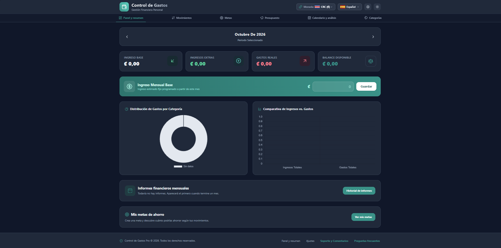
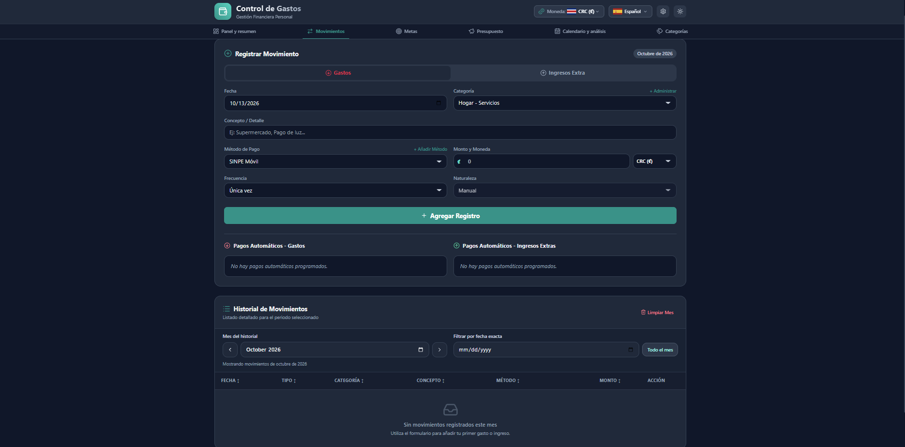
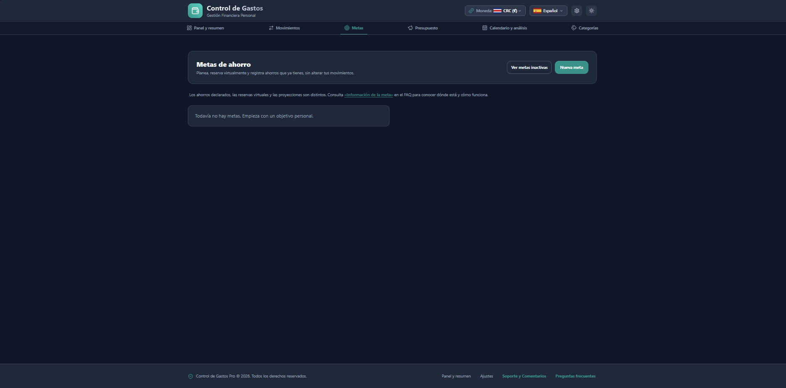
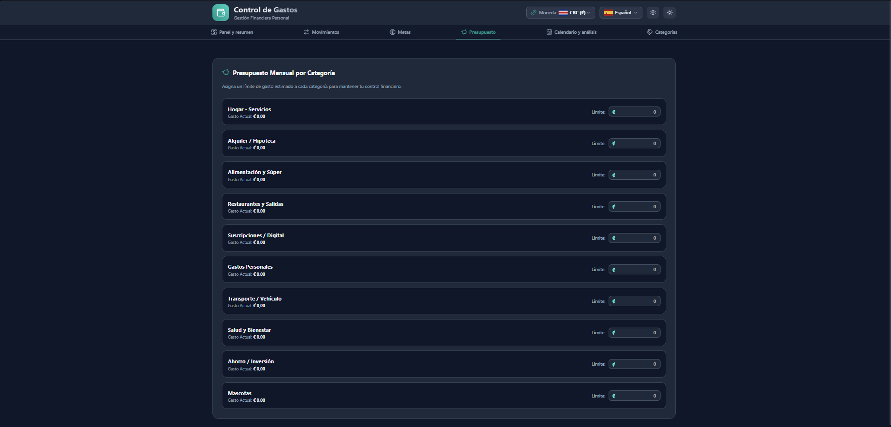
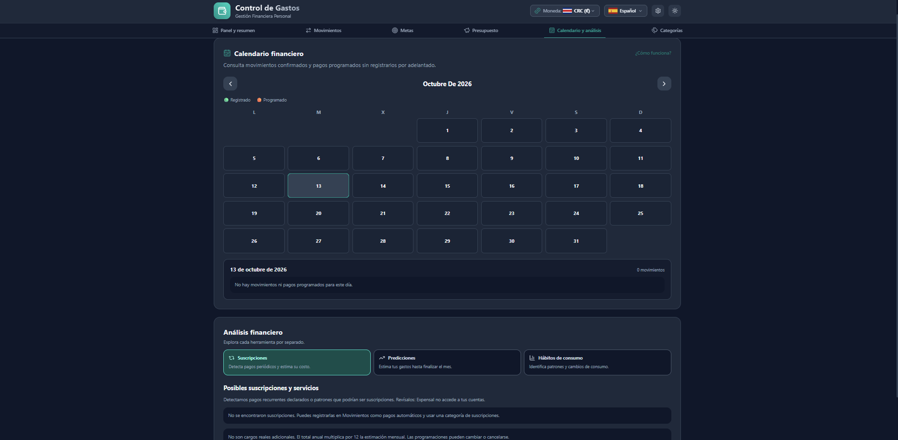
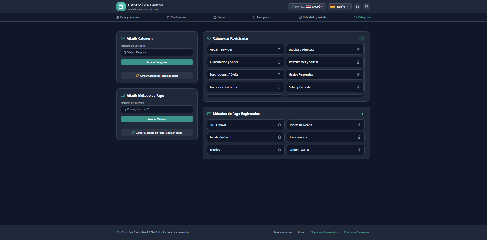
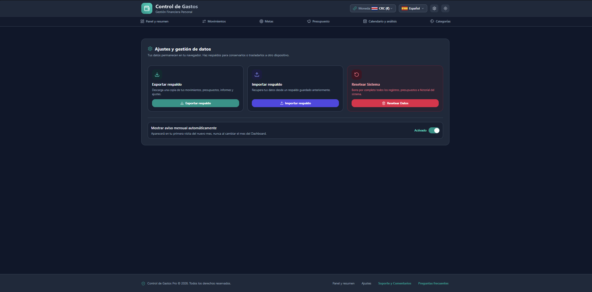

# 💚 Expensal

### Clearer finances. Closer goals.

**Track your finances, understand your spending habits, and plan your savings goals in one place.**

[**🇪🇸 Español**](README.md) · [**🇺🇸 English**](README_EN.md)

---

## ✨ Meet Expensal

**Expensal** is a personal finance web app for tracking income, expenses, budgets, and savings goals. Its responsive, bilingual interface and its focus on Costa Rican users help turn day-to-day records into practical financial insights.

  
  Actual app screenshot · Dashboard

## 🧩 Features

| Feature | What it does |
|:--|:--|
| **📊 Dashboard** | Displays income, expenses, balance, and category charts. |
| **💸 Transactions** | Records, edits, and filters income and expenses. |
| **🔁 Recurring payments** | Tracks scheduled entries, with options to confirm or skip them. |
| **🎯 Savings goals** | Combines user-declared savings, virtual allocations, and personalized suggestions. |
| **🐷 Budgets** | Tracks spending against category limits. |
| **🗓️ Financial calendar** | Shows recorded movements and scheduled payments by date. |
| **🔎 Financial insights** | Offers subscription analysis, spending estimates, and spending patterns. |
| **📈 Monthly reports** | Reviews prior periods with PDF and Excel exports. |
| **🏷️ Categories** | Manages custom categories and payment methods. |
| **⚙️ Settings and backups** | Exports, imports, and manages app preferences. |

> **💡 Information, not guarantees:** forecasts and recommendations are estimates meant to support the user's decisions.

## 📸 Screenshots

| Transactions | Savings goals |
|:--:|:--:|
|  |  |
| **Budgets** | **Calendar and insights** |
|  |  |
| **Categories and methods** | **Settings and backups** |
|  |  |

## 💚 Savings goals that adapt to you

Create savings goals, record money already saved, virtually allocate part of your available balance, and explore personalized savings approaches. Expensal can highlight deviations and suggest adjustments, but **it never moves money between bank accounts or automatically changes your goals**.

## 🌎 Languages and currencies

- **Languages:** Spanish and English.
- **Default currency for new visitors:** Costa Rican colón (CRC).
- **Other supported currencies:** USD, BTC, ETH, USDT.
- **Conversion rates:** weekly references for consistent conversions during the corresponding period.
- **Personalization:** light/dark mode and saved language/currency preferences.

## 🔐 Privacy and backups

Personal financial records are managed primarily through **browser-local storage**, with export/import features to transfer or restore them.

- No account is required to track your finances.
- Keep a backup: clearing browser site data may delete locally stored records.
- Exported backups **should not be treated as strongly encrypted confidential storage**; protect them like other financial files.
- Support requests and exchange rate lookups may contact external services.

## 🚀 Try it

### [Open Expensal →](https://expensal.com/)

Works in your browser on desktop, tablet, and mobile.

## 💬 Feedback

Ideas or bugs? Open a **[GitHub Issue](../../issues)** without sharing sensitive details, real financial records, or backup files. You can also use the in-app **Support & Feedback** section.

## 📄 About this repository

> **Public showcase repository.** It contains documentation and screenshots, **not the application's source code**. Use Expensal at [expensal.com](https://expensal.com/).

Publishing these materials does not grant a license to reuse or redistribute the software.

---

**Expensal · Organize today. Plan tomorrow.** 💚

[🌐 Website](https://expensal.com/) · [⬆ Back to top](#-expensal)

